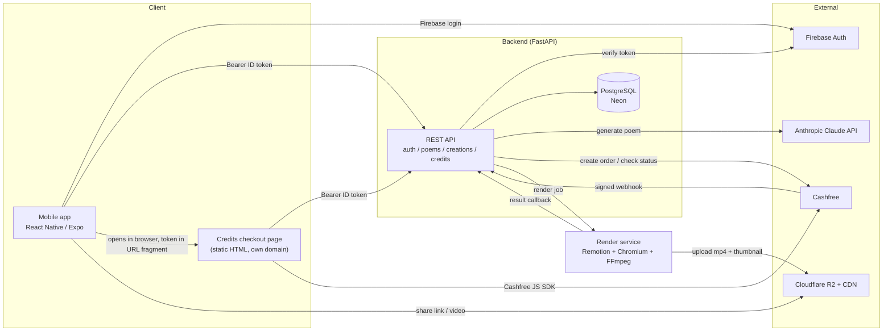
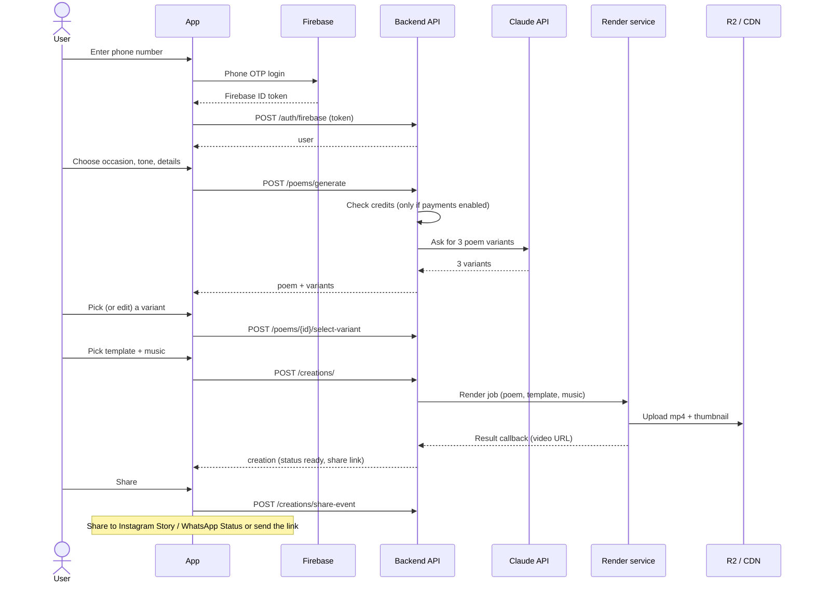

# Tweezers (twizzers) - Architecture, Services and Working Flow

Companion to `PROJECT_DISCUSSION.md` (product decisions). This file says **what each part is, which service does each job, and how a request flows end to end**. Keep it updated when a service changes.

Status legend: **Built** = code exists and was exercised in tests; **Partial** = code exists, not fully verified; **Planned** = decided, not built; **Idea** = not decided.

---

## 1. Services used, by task

### AI services

| Task | Service | Where in the repo | Status |
|---|---|---|---|
| Poem generation (3 variants per request) | **Anthropic Claude API** (model set in `backend/app/ai.py`, currently `claude-sonnet-4-6`) | `backend/app/ai.py` | Built. Without `ANTHROPIC_API_KEY` it returns demo text. Not run with a real key yet. |
| Poem animation / video | **No AI model.** Template-driven: code renders the poem as an animated video (Remotion). | `render-service/` | Built (see section 4) |
| Image generation (anime-style art) | **Not chosen.** Meta AI has no public API. Candidates: FLUX / Stable Diffusion via Replicate, fal.ai or Together; OpenAI image API; Google Imagen | - | Idea (Phase 4). See `PROJECT_DISCUSSION.md` 5b |
| Generative AI video | None. | - | Idea (Phase 4) |

### Web / infrastructure services

| Task | Service | Status |
|---|---|---|
| Login (phone OTP) | **Firebase Auth** (project `tweezer-5e9f2`). App signs in with Firebase, backend verifies the ID token with `google-auth` | Backend built (mocked token check). App login written (OTP, session restore, token refresh), not yet run on a device or against real Firebase; needs a development build and SHA fingerprints |
| Database | **PostgreSQL**: **Neon** in production, Postgres 16 container locally. Schema via **Alembic** | Built and run on local Postgres 16; Neon not set up yet |
| Payments | **Cashfree Payments** (orders API, JS checkout SDK, signed webhook). Credits are bought on a standalone web page, outside the app | Partial: tested with a mocked Cashfree only. Off by default (`PAYMENTS_ENABLED=false`) |
| Video rendering | **Remotion** (React) + headless Chromium + FFmpeg, self-hosted Node service | Built and run end to end locally (API to render service to callback); Dockerfile written but not built; not deployed |
| Media storage + CDN | **Cloudflare R2** + Cloudflare CDN (no egress fees) | Partial: the render service uploads to R2 when `R2_*` is set (tested against a fake S3 endpoint only; real R2 and CDN domain not set up) |
| Music | Licensed library (**Epidemic Sound** or **Artlist**) | Planned. For now: three original synthesised placeholder tracks served by the backend at `/static/music/` (render tested with audio) |
| Animated templates | Lottie / Rive files | Planned. Seed data uses placeholder URLs; the current video uses a code-drawn gradient with falling petals |
| Mobile app | **React Native (Expo, TypeScript)**; distributed on Google Play (App Store later) | Partial: all create-flow screens written, typechecks and bundles for Android; not run on a device; Firebase login written but untested (dev login is the default) |
| Credits checkout page hosting | **Cloudflare Pages** (static file on its own domain) | Planned |
| Backend API hosting | Render, Railway or Fly.io (pick a region near India) | Planned |
| Render worker hosting | Separate worker server, or Remotion Lambda on AWS | Planned |
| Admin dashboard | In-house: React web app served by the backend at `/admin` (same server, no extra hosting), API at `/admin/api`, roles, audit log | Built and tested on the API side (8 tests); UI type-checks and builds, Docker image stage written but not built, UI not yet clicked through in a browser |
| Analytics | PostHog or Mixpanel (create-to-share funnel) | Planned |
| Caching / sessions | Redis | Idea (not needed yet) |
| Physical card printing + delivery (Phase 2) | Print and delivery partners, flowers/chocolate vendors | Idea |
| Prepaid card value (Phase 3) | Card-issuing partner (needs KYC and legal advice) | Idea |

Not used: Razorpay (replaced by Cashfree), Supabase (Neon chosen), Clerk (Firebase chosen), Flutter / native Kotlin (React Native chosen).

---

## 2. System architecture

Components in the repo:

| Path | What it is |
|---|---|
| `backend/` | FastAPI + SQLAlchemy API, Alembic migrations, Dockerfile |
| `mobile/` | React Native (Expo) app: login, create flow, render status, share |
| `render-service/` | Remotion composition + HTTP service that queues and renders jobs, then calls the backend back |
| `web-checkout/credits.html` | Standalone credits purchase page |
| `frontend-demo/index.html` | Local demo page for the create flow (needs `AUTH_DEV_BYPASS=true`) |
| `docker-compose.yml` | Local Postgres + backend |
| `admin/` | Admin dashboard web app (see `admin/README.md`) |
| `docs/` | This file and `PROJECT_DISCUSSION.md` |

### Data model (Postgres)

`users` (with `firebase_uid`, `credits_balance`), `partners`, `poems`, `poem_variants`, `templates`, `music_tracks`, `creations`, `shares`, `credit_packs`, `credit_transactions`. A Phase 2 `orders` table (physical card) is not built.

`creations` is separate from `poems` so the same words can be reused with another template or music, and so the slow render step stays isolated.

### Security model

- Every user-owned route needs `Authorization: Bearer <Firebase ID token>` and checks that the row belongs to the caller (other users get 404).
- Public routes: templates, music, credit packs, `/creations/share/{slug}`, `/v/{slug}` (recipient HTML page), `/health`, and the Cashfree webhook (authenticated by its HMAC signature instead).
- `AUTH_DEV_BYPASS=true` is for local demos only; it must stay off everywhere else.
- Known gaps: CORS allows all origins; secrets must live in the host's environment settings.

---

## 3. Working flow

### 3.1 Create a poem video (main flow)

Today: users can also write their own poem (`POST /poems/write`). Credits are only checked and deducted when `PAYMENTS_ENABLED=true`; deduction happens after generation succeeds, so a failed AI call never charges.

Recipient view: the shared link is `/v/{slug}`, a public HTML page (video + poem, no login, poem text HTML-escaped); each open bumps the view counter. `GET /creations/share/{slug}` is the same data as JSON.

### 3.2 Buy credits (only when payments are on)

1. In the app, the user taps "Buy credits". The app opens `credits.html?api=...#token=<Firebase ID token>` in the **device browser / Chrome Custom Tab** (not an in-app WebView), so the purchase is outside Google Play Billing.
2. Page loads packs and the balance, user picks a pack.
3. `POST /credits/checkout/create-order`: backend saves a `credit_transactions` row (status `created`) and creates a Cashfree order; the page opens Cashfree's checkout with the returned `payment_session_id`.
4. After payment the page calls `POST /credits/checkout/verify`. The backend asks Cashfree for the order status and credits the wallet only if it is `PAID` for the right amount.
5. Cashfree also calls `POST /credits/webhook` (HMAC-signed). This is the backup if the browser closes before step 4.
6. Crediting is idempotent: verify and webhook can both fire and the wallet is credited once.
7. The page redirects back to the app via `tweezers://credits-success`.

### 3.3 Later phases

- **Phase 2:** physical printed card with a QR code to the digital poem, flowers/chocolate add-ons, shipping (new `orders` table).
- **Phase 3:** real gift-card value on the card (card-issuing partner, KYC, legal).
- **Phase 4:** AI-generated imagery or video, memory timeline, occasion reminders, premium tiers.

---

## 4. Render service

`render-service/` holds a Remotion composition, `PoemVideo`, that turns a poem into a 1080x1920 (9:16, Story-sized) H.264 video:

- gradient background chosen from the template's mood tags (romantic, playful, nostalgic, deeply romantic, gratitude, apology),
- poem lines fade in one by one, optional "For <name>" heading,
- falling petals, a small "TWEEZERS" watermark, fade-out at the end,
- optional music track with fade in/out,
- length scales with the poem (8 to 60 seconds).

The HTTP service (`src/server.mjs`) accepts jobs on `POST /render` (shared-secret header), renders them one at a time, writes an MP4 and a JPEG thumbnail, and calls the backend's `POST /creations/internal/{id}/render-result` (same secret). If a job fails while using a music URL it retries once without music. The backend sends a job when `RENDER_SERVICE_URL` is set; when it is empty, creations are marked `ready` immediately with a placeholder URL.

Verified locally (real Postgres, API, render service): creating a creation returned `rendering`, then `ready` with a playable 12.8 second 1080x1920 H.264 file and a thumbnail; a callback or render request with a wrong secret got 401. The seed now includes three synthesised placeholder tracks served by the backend; a render with one of them produced a video with an AAC audio track and no retry. A Hindi (Devanagari) poem renders correctly.

Uploads go to Cloudflare R2 when `R2_*` is set (verified against a fake S3 endpoint, not real R2); otherwise files stay on local disk. The `Dockerfile` (Chromium libraries, Noto fonts for Hindi, Remotion's headless Chrome) has not been built yet. Still to do for production: pick and set up the worker host, real Lottie/Rive templates, licensed music, (or Remotion Lambda instead of a worker), and checking Remotion's licensing terms for commercial use before launch.

---

## 5. Environment variables

| Variable | Used by | Purpose |
|---|---|---|
| `DATABASE_URL` | backend | Postgres connection (Neon in production, add `?sslmode=require`) |
| `ANTHROPIC_API_KEY` | backend | Claude poem generation (demo text if empty) |
| `FIREBASE_PROJECT_ID` | backend | Expected audience of Firebase ID tokens |
| `ADMIN_JWT_SECRET` | backend | Signs admin dashboard login tokens (16+ chars); empty keeps the admin API off |
| `AUTH_DEV_BYPASS` | backend | Local demo login. Never in production |
| `PAYMENTS_ENABLED` | backend | Master switch for credits and checkout |
| `COST_PER_STORY_CREDITS` | backend | Credits per poem generation (default 5) |
| `RENDER_SERVICE_URL` | backend | Render service address; empty means placeholder video URLs |
| `RENDER_SECRET` | backend, render-service | Shared secret for render jobs and result callbacks |
| `BACKEND_PUBLIC_URL` | backend | How the render service reaches the API for callbacks |
| `PORT`, `OUTPUT_DIR`, `PUBLIC_BASE_URL`, `BROWSER_EXECUTABLE` | render-service | Port, output folder, public file URL base, optional Chromium path |
| `R2_ENDPOINT`, `R2_ACCESS_KEY_ID`, `R2_SECRET_ACCESS_KEY`, `R2_BUCKET`, `R2_PUBLIC_BASE_URL` | render-service | Cloudflare R2 upload; all five needed, otherwise local files |
| `CASHFREE_CLIENT_ID`, `CASHFREE_CLIENT_SECRET` | backend | Cashfree API keys (the secret also signs webhooks) |
| `CASHFREE_ENV` | backend | `sandbox` or `production` |
| `CASHFREE_NOTIFY_URL` | backend | Optional webhook URL sent with each order |

---

## 6. Monthly cost estimate (rough, USD)

Written 16 Oct 2026 from third-party pricing summaries, not the vendors' own pricing pages, so **check each price before budgeting**. INR figures assume about Rs 88 per US dollar (an assumption). Nothing here includes taxes, the payment-gateway fee on revenue, or music licensing.

### Assumptions
- Prototype: you and a few testers.
- Early launch: 1,000 new users a month, 3,000 AI poems, 1,500 videos.
- Growth: 5,000 new users a month (about 10,000 active), 30,000 AI poems, 15,000 videos.
- A poem request sends about 200 tokens and returns about 300 to 450, so roughly $0.008 per request on `claude-sonnet-4-6` at $3 input / $15 output per million tokens (3 variants per request, `max_tokens` 800 so at most about $0.013).
- A finished video is about 0.7 MB (measured on a 13-second test render). Rendering takes tens of seconds of one CPU per video (unmeasured on a real host).
- Each new user needs about 1.3 SMS verifications.

### By service
| Item | Price used | Prototype | Early launch | Growth |
|---|---|---|---|---|
| API + admin host (Render) | Starter $7 (512 MB), Standard $25 (2 GB) | $0-7 | $7 | $25 |
| Render workspace plan | Hobby $0, Pro about $25 (unverified) | $0 | $0 | about $25 |
| Render service host (needs about 2 GB for Chromium) | Standard $25, Pro $85 | $0 (run locally) | $25 | $50-85 |
| Database (Neon) | about $0.106 per compute-hour (1 CU = 1 vCPU, 4 GB) + $0.35 per GB-month; free tier 100 CU-hours | $0 | $0-20 | $20-80 |
| Videos (Cloudflare R2) | $0.015 per GB-month, free egress, 10 GB free | $0 | $0 | about $1 |
| AI poems (Claude API) | about $0.008 per request | about $1 | about $24 | about $240 |
| Phone login SMS (Firebase, India) | about $0.06-0.07 per SMS (10 a day free); paid Blaze plan needed | $0 (test numbers) | about $70 | about $435 |
| Domain | about $12 a year | $1 | $1 | $1 |
| **Total** | | **about $2-10 (Rs 200-900)** | **about $130 (Rs 11,500)** | **about $800-890 (Rs 70,000-78,000)** |

One-time: Google Play developer account (about $25), Apple Developer account ($99 a year, only when you ship on iPhone). Both are unverified.

### What drives the bill
1. **SMS login is the biggest line.** About $0.07 per SMS is roughly Rs 6 per new user, more than the Rs 5 a poem sells for. Google sign-in costs nothing per user, and Indian SMS providers charge about Rs 0.4-0.6 per SMS, so a cheaper OTP route or Google sign-in would cut this by 90% or more.
2. **AI poems** are the second line, about Rs 0.7 each. A smaller model would cut it further (check pricing).
3. **Servers** are small. The render worker is the largest server cost because it runs a browser.
4. **Storage** is negligible for a long time. Egress from R2 is free.

### Revenue check (growth case)
30,000 poems at Rs 5 is about Rs 150,000 (about $1,700) before the gateway fee. The estimate above is about half of that. At the early-launch volume, roughly Rs 15,000 of revenue would be needed to cover about Rs 11,500 of cost.

### Not priced yet
- **Music licensing** (Epidemic Sound, Artlist or similar) for use inside a paid app is likely a commercial licence. Ask the vendors; it could be the largest unknown.
- **Remotion licence.** Remotion is free for individuals and for-profit organisations of up to 3 people, including commercial use. Beyond that, an automated pipeline like ours needs the paid "Automators" licence, listed at $0.01 per render with a $100 a month minimum (at 15,000 renders a month that is $150). Confirm on remotion.dev/docs/pricing and ask Remotion if unsure whether your team counts.
- Payment gateway fee (Cashfree, a percentage of each payment).
- Analytics (PostHog, Mixpanel; free tiers exist), error monitoring, EAS cloud builds for the app, and your own time.

Sources used: Render, Neon, Cloudflare R2, Firebase and Anthropic pricing summaries found on 16 Oct 2026 (Render's own article on hosting costs, Jet Admin's Neon pricing review, Cloudflare's R2 pricing page preview, Magora's Firebase pricing guide, anotherwrapper.com's Claude pricing pages). Treat them as approximate.

### Hosting options for the API + admin container (one small container, about 0.5 CPU and 512 MB to 1 GB)

Prices are third-party summaries from 16 Oct 2026 and unverified; the Mumbai/India notes matter because most users are in India.

| Option | What it is | Rough monthly cost, always on | India region | Notes |
|---|---|---|---|---|
| **Render** | Managed platform, reported to run on AWS (Singapore = AWS ap-southeast-1) | Starter $7 (512 MB), Standard $25 (2 GB) | No India region; Singapore is the closest | Simplest. Free tier sleeps. |
| **Railway** | Managed platform | Pay for usage: about $20 per vCPU-month and $10 per GB-month, Hobby plan $5 including $5 of usage; a small API is about $5-15 | Not checked | Easy deploys; bill follows actual use. |
| **Fly.io** | Managed platform on its own machines | About $3-4 for a 512 MB shared CPU (sources disagree) | Mumbai (bom) not confirmed | Cheapest always-on; no free tier for new accounts. |
| **Google Cloud Run** | Run the container on GCP, billed per use, scales to zero | About $0-10 at low traffic (free tier includes Mumbai asia-south1); more if kept warm | Mumbai (asia-south1) | Cheapest at low traffic and closest to users; more setup. Cold starts, and migrations should run as a separate step. |
| **AWS Lightsail containers** | Containers on AWS | From about $7 | Mumbai (ap-south-1); included data transfer is halved there | AWS App Runner/ECS cost was not found. |
| **Cloudflare** | Not suitable for the API itself | - | - | Use it for R2 storage, CDN, DNS/DDoS protection and the checkout page. Its Workers do not run this FastAPI + Postgres + Chromium stack as is; Cloudflare Containers were not checked. |

The render service needs 2 GB or more and is billed separately (see the table above). Neon should be in a region near the API, because every request talks to the database.

### If AWS is the choice (16 Oct 2026, third-party prices, mostly US East examples, Mumbai rates differ)

| AWS option | Fits the API | Fits the render service | Rough monthly cost (early launch) | Catch |
|---|---|---|---|---|
| **Lightsail containers** | Yes, simplest. Nano $7 (512 MB, 0.25 vCPU), Micro about $10, Small about $15, Medium $40 (only Nano and the Medium price are confirmed by AWS docs); includes a load balancer, HTTPS and 500 GB transfer | Only Medium or larger, and CPU is limited, so renders are slow | API about $10 + render $15-40 = about $25-50 | Small CPUs; no on-demand rendering |
| **ECS on Fargate** | Yes, but needs more setup (VPC, load balancer, IAM, logs) | Yes; best used as on-demand tasks per render (needs code to start tasks) | API about $18 (0.5 vCPU, 1 GB at $0.04048 per vCPU-hour and $0.004445 per GB-hour) + load balancer about $16-22 + public IPv4 about $4 = about $40; render always on (2 vCPU, 4 GB) about $72, or on demand about $3 at 1,500 renders | Load balancer and IP charges; NAT gateway if you use private subnets; most work |
| **Lambda** | Possible with an adapter, but cold starts and database connections need care; about $0-5 | Remotion has a Lambda renderer (`renderMediaOnLambda`) that renders in parallel, but it is a different code path from what we built | API about $0-5; render AWS compute plus the Remotion licence | Needs rewrites; licence minimum of $100 a month if over 3 people |

Simplest AWS setup: API on Lightsail Micro, render service on Lightsail Medium (about $50 a month together, against about $32 on Render). Revisit Fargate or Remotion Lambda only at volume. AWS is not cheaper or simpler than Render or Railway at this size; the reasons to pick it are credits, a Mumbai region or wanting everything in one cloud account.

### If Google Cloud is the choice (16 Oct 2026, third-party prices, unverified)

Cloud Run runs a container and bills per second of use, and Mumbai (`asia-south1`) is a region. Rates used for Mumbai (tier 2): about $0.0000336 per vCPU-second, $0.0000035 per GiB-second, $0.40 per million requests; monthly free allowance of roughly 180,000 vCPU-seconds, 360,000 GiB-seconds and 2 million requests (figures differ between Google's pages, and one source claims a cheaper rate from August 2026, which I could not confirm).

| GCP option | API + admin | Render service | Rough monthly cost |
|---|---|---|---|
| **Cloud Run** (scales to zero) | Fits. Early launch fits inside the free allowance (about $0); growth about $10. Keeping one instance warm to avoid cold starts is about $10-15 more (idle rate from a third-party source) | Fits only after a code change (see below). About $0.005 per render at 1 minute of 2 vCPU and 4 GiB, so about $0-8 at 1,500 renders and about $65 at 15,000 | Early launch about $0-20, growth about $75-80 |
| **Compute Engine VM** (one machine running our docker compose) | Fits unchanged | Fits unchanged | e2-medium (2 vCPU, 4 GB) about $29, e2-standard-2 (2 vCPU, 8 GB) about $59 in Mumbai; another source says about $48 and $58, so check |
| **GKE Autopilot** | Overkill at this size | Overkill | Not priced |

Code changes needed for Cloud Run:
1. **Render service.** Under the default request-based billing, CPU is throttled once a response is sent, so our "accept the job, return 202, render in the background" design can stall. Fixes: a synchronous render endpoint called through Cloud Tasks (a request can run long), a Cloud Run job per render, or instance-based billing (CPU always on, which costs more).
2. **Migrations.** The image runs `alembic upgrade head` on every start; on Cloud Run run it once as a deploy step or job instead.
3. **Database connections.** Many instances can open many connections: use Neon's pooled connection string and a small connection pool.
4. **Admin login throttling** is kept in memory per instance, so it is weaker when several instances run.

Compared with Render at the same size (about $32 early launch): Cloud Run is cheaper at low volume and has a Mumbai region, but needs the changes above; a single VM is simple and unchanged but you maintain the machine (updates, HTTPS, restarts).

### Neon (Postgres) in detail (16 Oct 2026, third-party prices, unverified)

Rates reported: Launch plan about $0.106 per compute unit-hour (1 CU = 1 vCPU and 4 GB of memory), Scale plan about $0.222 per CU-hour, storage $0.35 per GB-month on both; Free plan includes 100 CU-hours and 0.5 GB per project. One source says paid plans have had no monthly minimum since December 2025; another lists flat $19 / $69 plans that conflict, so check Neon's pricing page.

Our database is tiny: poems, users, creations and logs are text, so 10,000 poems is only a few tens of MB. Storage stays under $1 for a long time. Compute is what you pay for.

| Case | Compute use | Cost per month |
|---|---|---|
| Prototype | a few hours a day, scale-to-zero | $0 (Free plan) |
| Early launch, scale-to-zero, active about 12 h a day at 0.25 CU | about 90 CU-hours | about $0 on the Free plan, about $10 on a paid plan |
| Early launch, always on at 0.25 CU | 180 CU-hours | about $19 |
| Growth, always on at 0.5 CU | 365 CU-hours | about $39 |
| Growth, always on at 1 CU | 730 CU-hours | about $77 |

Scale-to-zero saves money but the first request after idle waits for the database to wake up; turn it off before launch if that delay matters. Keep the API in a region close to Neon (Singapore is available on AWS; a Mumbai region was not confirmed).
