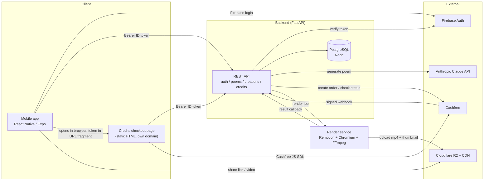
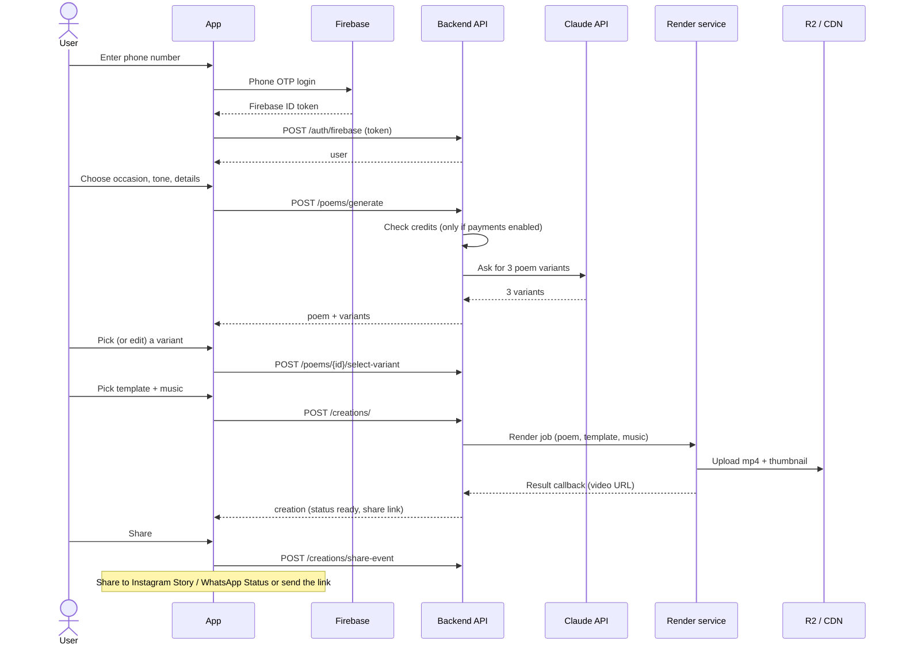

# Tweezers (twizzers) - Architecture, Services and Working Flow

Companion to `PROJECT_DISCUSSION.md` (product decisions). This file says **what each part is, which service does each job, and how a request flows end to end**. Keep it updated when a service changes.

Status legend: **Built** = code exists and was exercised in tests; **Partial** = code exists, not fully verified; **Planned** = decided, not built; **Idea** = not decided.

---

## 1. Services used, by task

### AI services

| Task | Service | Where in the repo | Status |
|---|---|---|---|
| Poem generation (3 variants per request) | **Anthropic Claude API** (model set in `backend/app/ai.py`, currently `claude-sonnet-4-6`) | `backend/app/ai.py` | Built. Without `ANTHROPIC_API_KEY` it returns demo text. Not run with a real key yet. |
| Poem animation / video | **No AI model.** Template-driven: code renders the poem as an animated video (Remotion). | `render-service/` | Partial (see section 4) |
| Image generation (anime-style art) | **Not chosen.** Meta AI has no public API. Candidates: FLUX / Stable Diffusion via Replicate, fal.ai or Together; OpenAI image API; Google Imagen | - | Idea (Phase 4). See `PROJECT_DISCUSSION.md` 5b |
| Generative AI video | None. | - | Idea (Phase 4) |

### Web / infrastructure services

| Task | Service | Status |
|---|---|---|
| Login (phone OTP) | **Firebase Auth**. App signs in with Firebase, backend verifies the ID token with `google-auth` | Built on the backend (mocked token check); app login screen not built |
| Database | **PostgreSQL**: **Neon** in production, Postgres 16 container locally. Schema via **Alembic** | Built and run on local Postgres 16; Neon not set up yet |
| Payments | **Cashfree Payments** (orders API, JS checkout SDK, signed webhook). Credits are bought on a standalone web page, outside the app | Partial: tested with a mocked Cashfree only. Off by default (`PAYMENTS_ENABLED=false`) |
| Video rendering | **Remotion** (React) + headless Chromium + FFmpeg, self-hosted Node service | Partial |
| Media storage + CDN | **Cloudflare R2** + Cloudflare CDN (no egress fees) | Planned. Renders are currently written to local disk |
| Music | Licensed library (**Epidemic Sound** or **Artlist**) | Planned. Seed data uses placeholder URLs |
| Animated templates | Lottie / Rive files | Planned. Seed data uses placeholder URLs; the current video uses a code-drawn gradient with falling petals |
| Mobile app | **React Native (Expo, TypeScript)**; distributed on Google Play (App Store later) | Blank scaffold only (`mobile/`) |
| Credits checkout page hosting | **Cloudflare Pages** (static file on its own domain) | Planned |
| Backend API hosting | Render, Railway or Fly.io (pick a region near India) | Planned |
| Render worker hosting | Separate worker server, or Remotion Lambda on AWS | Planned |
| Analytics | PostHog or Mixpanel (create-to-share funnel) | Planned |
| Caching / sessions | Redis | Idea (not needed yet) |
| Physical card printing + delivery (Phase 2) | Print and delivery partners, flowers/chocolate vendors | Idea |
| Prepaid card value (Phase 3) | Card-issuing partner (needs KYC and legal advice) | Idea |

Not used: Razorpay (replaced by Cashfree), Supabase (Neon chosen), Clerk (Firebase chosen), Flutter / native Kotlin (React Native chosen).

---

## 2. System architecture

Components in the repo:

| Path | What it is |
|---|---|
| `backend/` | FastAPI + SQLAlchemy API, Alembic migrations, Dockerfile |
| `mobile/` | React Native (Expo) app, blank template so far |
| `render-service/` | Remotion composition (and, in progress, the HTTP service that renders it) |
| `web-checkout/credits.html` | Standalone credits purchase page |
| `frontend-demo/index.html` | Local demo page for the create flow (needs `AUTH_DEV_BYPASS=true`) |
| `docker-compose.yml` | Local Postgres + backend |
| `docs/` | This file and `PROJECT_DISCUSSION.md` |

### Data model (Postgres)

`users` (with `firebase_uid`, `credits_balance`), `partners`, `poems`, `poem_variants`, `templates`, `music_tracks`, `creations`, `shares`, `credit_packs`, `credit_transactions`. A Phase 2 `orders` table (physical card) is not built.

`creations` is separate from `poems` so the same words can be reused with another template or music, and so the slow render step stays isolated.

### Security model

- Every user-owned route needs `Authorization: Bearer <Firebase ID token>` and checks that the row belongs to the caller (other users get 404).
- Public routes: templates, music, credit packs, `/creations/share/{slug}`, `/health`, and the Cashfree webhook (authenticated by its HMAC signature instead).
- `AUTH_DEV_BYPASS=true` is for local demos only; it must stay off everywhere else.
- Known gaps: CORS allows all origins; secrets must live in the host's environment settings.

---

## 3. Working flow

### 3.1 Create a poem video (main flow)

Today: users can also write their own poem (`POST /poems/write`). Credits are only checked and deducted when `PAYMENTS_ENABLED=true`; deduction happens after generation succeeds, so a failed AI call never charges.

Recipient view: anyone with the link calls `GET /creations/share/{slug}` (no login) and the view counter goes up.

### 3.2 Buy credits (only when payments are on)

1. In the app, the user taps "Buy credits". The app opens `credits.html?api=...#token=<Firebase ID token>` in the **device browser / Chrome Custom Tab** (not an in-app WebView), so the purchase is outside Google Play Billing.
2. Page loads packs and the balance, user picks a pack.
3. `POST /credits/checkout/create-order`: backend saves a `credit_transactions` row (status `created`) and creates a Cashfree order; the page opens Cashfree's checkout with the returned `payment_session_id`.
4. After payment the page calls `POST /credits/checkout/verify`. The backend asks Cashfree for the order status and credits the wallet only if it is `PAID` for the right amount.
5. Cashfree also calls `POST /credits/webhook` (HMAC-signed). This is the backup if the browser closes before step 4.
6. Crediting is idempotent: verify and webhook can both fire and the wallet is credited once.
7. The page redirects back to the app via `tweezers://credits-success`.

### 3.3 Later phases

- **Phase 2:** physical printed card with a QR code to the digital poem, flowers/chocolate add-ons, shipping (new `orders` table).
- **Phase 3:** real gift-card value on the card (card-issuing partner, KYC, legal).
- **Phase 4:** AI-generated imagery or video, memory timeline, occasion reminders, premium tiers.

---

## 4. Render service

`render-service/` holds a Remotion composition, `PoemVideo`, that turns a poem into a 1080x1920 (9:16, Story-sized) H.264 video:

- gradient background chosen from the template's mood tags (romantic, playful, nostalgic, deeply romantic, gratitude, apology),
- poem lines fade in one by one, optional "For <name>" heading,
- falling petals, a small "TWEEZERS" watermark, fade-out at the end,
- optional music track with fade in/out,
- length scales with the poem (8 to 60 seconds).

Verified: a sample render produced a valid 12.8 second 1080x1920 H.264 file using the sandbox's Chromium. Audio with a real music URL has not been tested.

In progress: an HTTP service wrapping the renderer (job queue, secret-protected, result callback to the backend) and the backend hook that sends render jobs to it. Until that is wired up, the backend still marks creations `ready` immediately with a placeholder URL.

Still to do for production: upload to Cloudflare R2, thumbnail, real Lottie/Rive templates, licensed music, a worker host (or Remotion Lambda), and checking Remotion's licensing terms for commercial use before launch.

---

## 5. Environment variables

| Variable | Used by | Purpose |
|---|---|---|
| `DATABASE_URL` | backend | Postgres connection (Neon in production, add `?sslmode=require`) |
| `ANTHROPIC_API_KEY` | backend | Claude poem generation (demo text if empty) |
| `FIREBASE_PROJECT_ID` | backend | Expected audience of Firebase ID tokens |
| `AUTH_DEV_BYPASS` | backend | Local demo login. Never in production |
| `PAYMENTS_ENABLED` | backend | Master switch for credits and checkout |
| `COST_PER_STORY_CREDITS` | backend | Credits per poem generation (default 5) |
| `CASHFREE_CLIENT_ID`, `CASHFREE_CLIENT_SECRET` | backend | Cashfree API keys (the secret also signs webhooks) |
| `CASHFREE_ENV` | backend | `sandbox` or `production` |
| `CASHFREE_NOTIFY_URL` | backend | Optional webhook URL sent with each order |
